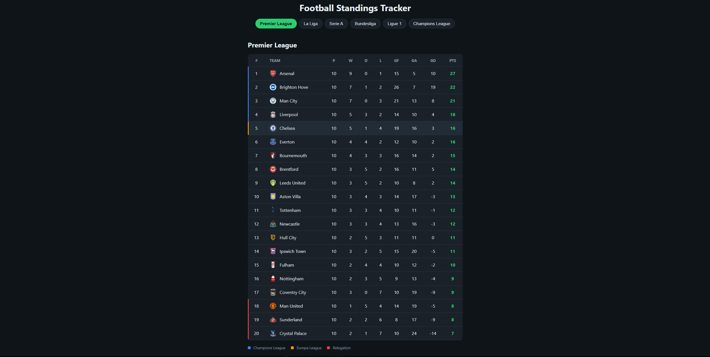

# Football Standings Tracker

A web app to follow the standings of Europe's top 5 leagues plus the Champions League, with live data and team profile pages.

**Live demo:** https://clmenn.github.io/football-tracker/

## Features

- Standings for the Premier League, La Liga, Serie A, Bundesliga, Ligue 1 and the Champions League
- Colored markers for Champions League, Europa League, Conference League and relegation spots, with a legend that adapts to each league
- Team profile pages with coach, venue, club colors and full squad grouped by position
- Responsive layout, with a horizontally scrollable table on mobile
- Loading and error states

## Tech stack

- HTML, CSS and vanilla JavaScript (no frameworks)
- [football-data.org](https://www.football-data.org/) API for the data
- Cloudflare Workers as a small proxy
- GitHub Pages for hosting

## How it works

The browser can't call the football API directly, because the API blocks requests from other websites (CORS) and the API key would be visible in the page source. So the site talks to a small Cloudflare Worker (`worker/worker.js`) that:

1. Only accepts known league codes and numeric team ids
2. Adds the secret API key on the server side
3. Caches responses for 10 minutes, to stay within the API's rate limit
4. Returns the data with the CORS headers the site needs

On the frontend, each league is fetched once and cached in memory, so switching tabs is instant. League zones (Champions League spots, relegation, etc.) are stored as data per league, and both the row colors and the legend are generated from it.

## Run locally

1. Clone the repo
2. Open the folder in VS Code and start it with the Live Server extension
3. To use your own data source, deploy the Worker in `worker/`, add your football-data.org token as a secret named `API_KEY`, and set `WORKER_URL` in `script.js` and `team.js`

## Notes

- Qualification spots are the usual ones and can change between seasons, so check the current rules if you need exact values
- Data comes from football-data.org's free tier, which is for personal and educational use

## What I learned

- Fetching and handling async data with `fetch` and `async/await`
- Debugging CORS and building a serverless proxy
- Generating UI from data, and keeping data separate from presentation
- Deploying with Git and GitHub Pages